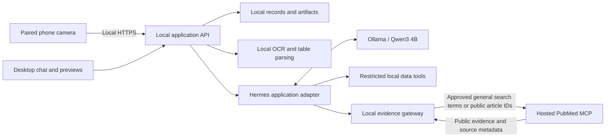

**Project specification: Local Medical Assistant**

Version 1.0 · 24 October 2026 · Proposed MVP and implementation requirements

**1. Product definition**

A locally hosted web application that helps doctors read medical records, organize patient data, create files, and research medical questions. Patient records, conversations, OCR, model inference, and generated artifacts remain on the doctor's workstation or clinic server. A dedicated online medical MCP supplies public evidence through a restricted local gateway.

The desktop experience is a chat interface with an adjacent artifact panel. A paired phone provides a camera and upload interface. Doctors can inspect spreadsheets, images, PDFs, extracted data, and generated reports inside the application before downloading anything.

The application must distinguish three things: information transcribed from a patient record, information retrieved from medical literature, and the assistant's interpretation. Retrieved evidence reduces unsupported answers; it does not eliminate hallucinations or establish that an answer is clinically correct.

Assumptions for the first release: one doctor per installation, one active case per conversation, one paired phone, a trusted local network, and English printed records as the initial acceptance baseline. Arabic and mixed-language records are planned through the same OCR architecture, but require their own validation before being advertised as supported. “Hermes” means Nous Research's Hermes Agent. Ollama and Qwen3 4B are already installed, as reported by the project owner; their configuration has not been inspected for this specification.

**2. Selected architecture and technologies**

| Component | Selection | Responsibility |
|---|---|---|
| Desktop and phone UI | React, TypeScript, Vite | Chat, capture, review, artifact previews |
| Local application API | Python FastAPI | Authentication, cases, uploads, jobs, streaming events |
| Agent harness | Hermes Agent, pinned release behind an application adapter | Local conversation and restricted tool orchestration |
| Local inference | Ollama with `qwen3:4b` | Intent recognition, structured extraction proposals, evidence synthesis |
| Online knowledge service | Hosted `cyanheads/pubmed-mcp-server` | Public biomedical literature retrieval |
| Privacy boundary | Dedicated local evidence gateway | Validate outbound requests and enforce the remote tool allowlist |
| OCR | PaddleOCR PP-OCRv5; PP-StructureV3 for document layout and tables | Local text recognition and table reconstruction |
| Image preprocessing | OpenCV | Rotation, deskew, perspective correction, image-quality checks |
| Structured data processing | pandas and openpyxl | Read and transform tables; write XLSX |
| PDF handling | pypdf and pypdfium2 | Extract embedded text and render scanned pages locally |
| Report generation | python-docx and a local PDF renderer | DOCX and PDF reports from controlled templates |
| Storage | SQLite with FTS5 plus a local artifact directory | Case metadata, text search, versions, files, audit events |
| Deployment | Local services or Docker Compose; host Ollama | Reproducible installation and process isolation |

These are implementation selections, not a claim that the complete stack has already been integrated. Pin dependency versions and model checksums after the compatibility milestone.

**3. Online medical MCP decision**

Select **the hosted cyanheads PubMed MCP for the MVP**, at `https://pubmed.caseyjhand.com/mcp`, using Streamable HTTP through our evidence gateway. It is the best fit among the reviewed options for this project's immediate requirements: a published online endpoint, inspectable connector source, broad biomedical literature access, and identifiable source records. This is a project-specific selection, not a universal ranking or a production service endorsement.

The maintainer documents PubMed search, article metadata, available full text, citation formatting, and retraction/correction information. It is a third-party connector, not an NLM-operated service. [Maintainer documentation](https://github.com/cyanheads/pubmed-mcp-server)

| Reviewed option | Assessment for this project |
|---|---|
| Hosted cyanheads PubMed MCP | Selected for the initial evidence retrieval integration |
| BioMCP | A broader alternative with documented remote deployment, but the reviewed documentation describes running a server rather than establishing a managed public endpoint for this application. [Remote deployment documentation](https://biomcp.org/getting-started/remote-http/) |
| Open Targets MCP | Provides an official hosted endpoint; its focus on targets and drug discovery is narrower than a general doctor's literature workflow. [Provider documentation](https://platform-docs.opentargets.org/data-access/model-context-protocol) |
| Unofficial OpenEvidence MCP | Relies on a logged-in browser bridge, adding account and integration dependencies unsuitable for the initial backend. [Maintainer documentation](https://github.com/htlin222/openevidence-mcp) |

Use only an explicitly approved subset of remote tools: `pubmed_search_articles`, `pubmed_fetch_articles`, and `pubmed_fetch_fulltext`. The gateway maps application operations to their discovered schemas; it must not expose newly added remote tools automatically. [Tool reference](https://raw.githubusercontent.com/cyanheads/pubmed-mcp-server/main/README.md)

PubMed is a literature index, not a comprehensive clinical guideline or prescribing service. It provides citations and abstracts; full text may require another site or a subscription. The UI must distinguish an accessible citation page from accessible full text. [NLM description](https://pubmed.ncbi.nlm.nih.gov/about/)

For questions needing a current local guideline, formulary, or prescribing reference that the service cannot supply, the assistant must report that limitation. It may also use a doctor-uploaded guideline locally, with its date and jurisdiction displayed. Do not imply that an individual paper establishes a guideline.

Verification status: the hosted endpoint and capabilities were verified against published maintainer documentation. A direct protocol probe from this workspace could not run because DNS resolution was unavailable. Live connectivity, negotiated protocol compatibility, authentication, quotas, retention terms, permitted use, and operational reliability remain mandatory integration checks. No uptime, price, or zero-retention commitment is assumed. A public endpoint may change; keep the provider replaceable and never silently switch providers.

**4. Privacy and network boundary**

The product's core requirement is that patient-identifying information must not be transmitted to external AI providers or the remote MCP. A prompt telling the model to remove names is insufficient enforcement.

Only the evidence gateway may make application-initiated internet requests during normal operation. The agent, OCR worker, document processors, and model runtime must have internet egress denied at the process/container boundary. Inference remains available over a private local connection. Provider and model downloads occur during a separate setup/update step with no patient content loaded.

Outbound search flow:

1. Hermes proposes a structured research topic locally.
2. The gateway accepts a small schema of controlled medical concepts, broad population categories, study types, and literature publication-date filters. It accepts neither a patient narrative nor arbitrary query strings from the model.
3. Terms must resolve against an installed local vocabulary or an administrator-maintained allowlist. The gateway generates the actual search syntax. Unrecognized terms stay local pending review.
4. The doctor sees and approves the general research query before its first transmission. Approval binds to the exact request; changing its concepts requires a new approval. Generalization must also address unusual combinations that could identify a person.
5. Deterministic validation and local identifier detection block names, record numbers, contact details, exact dates of birth, encounter dates, addresses, filenames, patient IDs, raw OCR, and record fragments. A detected identifier cannot be overridden in this workflow; the query must be rewritten.
6. Fetches accept only public article identifiers from returned results or a separately validated public citation, never arbitrary URLs.

For example, a local question containing a name, hospital number, exact age, and clinical history might yield the approved external topic “adult type 2 diabetes chronic kidney disease systematic review.” The original question and its connection to the patient remain local. Complex or rare patient combinations must be broadened or researched manually without exporting a case narrative.

The service still sees approved topics, timing, and the installation's public IP. Minimized queries are not a mathematical guarantee of anonymity. If a question cannot be safely generalized, the application must decline the external lookup and continue with local material.

Additional requirements:

- Disable cloud inference fallbacks, cloud OCR, external embeddings, analytics, session replay, remote error-report payloads, and runtime CDN assets.
- Keep all background model work local, including summaries, titles, compression, and any optional classification.
- Deny MCP sampling requests, remote elicitation of local data, unsolicited callbacks, and automatic resource fetching.
- Treat records, retrieved articles, and MCP tool descriptions as untrusted data; their instructions cannot grant tool access.
- Enforce tool permissions and case scope in application code, independent of model output.
- Apply request-size limits, response-size limits, timeouts, TLS validation, a hostname allowlist, and redirect restrictions at the gateway.
- Open citation sites only after a doctor clicks a canonical source link, using `noopener` and `noreferrer`. Do not embed external pages, tracking pixels, or remote images in the patient workspace.

**5. Main user journeys**

**Record to spreadsheet.** The doctor opens a case, selects “Scan with phone,” photographs a printed record, and uploads it over the local network. The desktop shows processing progress, then a split view of the image and extracted fields. The doctor corrects values and confirms the extraction. On “Create an Excel sheet,” the agent calls a local export tool and returns a spreadsheet artifact that opens in the side panel.

**Existing data to a new artifact.** The doctor uploads XLSX, CSV, or JSON and asks for a table, filtered dataset, summary, or report. The system parses the file directly, previews its structure, performs a validated transformation, and creates a new version. It does not silently overwrite the input.

**Evidence-supported question.** The doctor asks a medical question. The assistant separates the local patient context from a general research topic. After approval of the outgoing topic, the gateway retrieves literature. Qwen receives the selected evidence locally, drafts a response with source references, and distinguishes evidence from case-specific interpretation.

**Follow-up revision.** The doctor requests changes such as “Add a units column,” “Sort by collection date,” or “Make a PDF summary.” The application creates a new artifact version from the underlying structured dataset and records the transformation.

**6. Chat and artifact interface**

Desktop layout: a case/conversation sidebar, central chat, and a resizable artifact panel. Mobile layout: capture and upload first, with responsive review where practical.

Required interface behavior:

- Upload by drag-and-drop, file picker, or paired phone.
- Show stages such as uploaded, parsing, OCR, needs review, retrieving evidence, generating, ready, and failed.
- Let the doctor cancel long-running work and retry a failed stage without duplicating artifacts.
- Show source chips on evidence-backed statements and local-record references on transcribed patient facts.
- Display the active case persistently and prevent cross-case attachment access.
- Show extraction review state and identify artifacts that contain unreviewed values.
- Keep version history, allow correction, and offer an explicit download button.

| Artifact | Preview behavior |
|---|---|
| XLSX / CSV | Virtualized table, sheet tabs, search, sort, filter, cell editing, units, and source references |
| JSON | Expandable tree plus tabular view for compatible arrays |
| Image | Zoom, rotate, and OCR bounding-box overlays |
| PDF | Local page rendering, navigation, and zoom |
| DOCX report | Sanitized HTML or locally generated PDF preview of the same document content |
| Generated text/report | Sanitized Markdown with evidence links |

Spreadsheet previews must disclose unsupported workbook features. Exact Excel formatting, charts, pivot tables, and recalculation are outside the first release. Never execute workbook macros, external links, or uploaded active content. Missing cached formula results must be labeled unavailable rather than invented.

**7. Phone capture specification**

The workstation displays a QR code for a short-lived, single-use pairing token. The doctor opens the local capture site on the phone, confirms pairing on the workstation, and receives a session restricted to uploading into the selected case. The token must not contain patient details or appear in server access logs; exchange and remove it immediately.

The phone and workstation must be on the same permitted network. Provide trusted HTTPS using a clinic-installed local certificate authority or an institution-managed certificate; camera access must be tested on the supported mobile browsers. Do not solve certificate problems by forwarding patient images through a public upload relay.

Capture supports multiple pages, retake, reorder, crop, rotation, and upload progress. The capture page displays blur/glare warnings when feasible. On arrival, strip image metadata from the working copy and retain the original only in local protected storage if retention is enabled.

Use an in-browser camera stream where supported to avoid deliberately saving captures to the photo library. The application cannot control operating-system screenshots, gallery uploads, or device cloud backups. Clinic device configuration must account for those separate storage paths.

**8. Local OCR and document ingestion**

Choose PaddleOCR PP-OCRv5 as the initial text recognizer and PP-StructureV3 for layout/table reconstruction. Run the Python inference pipelines locally with downloaded model files; do not use PaddleOCR's hosted API. PP-StructureV3 provides structured document/table outputs, including table export. [Pipeline documentation](https://www.paddleocr.ai/main/en/version3.x/pipeline_usage/PP-StructureV3.html)

| Input | Processing path |
|---|---|
| JPEG / PNG | Decode, preprocess, detect layout, OCR, reconstruct fields/tables |
| Scanned PDF | Render each page locally, then use the image pipeline |
| Text PDF | Extract embedded text and coordinates; OCR only image-only or failed regions |
| XLSX / CSV | Read cells directly; no OCR of ordinary spreadsheet values |
| JSON | Validate and preserve original structure; map selected arrays into tables |
| Spreadsheet containing images | Parse native cells and offer separate OCR for selected embedded images |

Pipeline requirements:

1. Validate actual file type, size, page count, and decompressed size before processing.
2. Keep an immutable original, local content hash, and explicit case association.
3. Produce a normalized working image without replacing the original.
4. Extract text spans, table cells, page numbers, coordinates, and recognition scores.
5. Create canonical document JSON. Preserve raw text alongside any parsed value.
6. Use Qwen only to propose labels and mappings into schemas. It must not fill missing medical values from prior knowledge.
7. Apply deterministic checks for numeric parsing, dates, units, row alignment, and missing fields. Never silently change units or decimal punctuation.
8. Show the image and extracted data together for review. Uncertain or unreadable values remain unknown.
9. Mark doctor-confirmed fields and freeze a reviewed dataset version for subsequent interpretation/export.

Recognition scores are engine scores, not calibrated probabilities of clinical correctness. In the MVP, all clinically material OCR values used for interpretation—medication names, doses, lab values, units, dates, allergies, and patient association—require review regardless of score. Draft exports are allowed if their unreviewed status is conspicuous.

Handwriting, stamps over text, severe blur, and unusual layouts are best effort. If extraction is unreliable, request a clearer capture or manual transcription. Do not silently switch to a cloud vision service.

PaddleOCR documents an Arabic recognizer, but language availability alone does not establish accuracy on mixed Arabic/English medical tables. Validate Arabic text order, Arabic-Indic digits, decimal separators, and medical abbreviations separately. [Multilingual model documentation](https://www.paddleocr.ai/main/en/version3.x/algorithm/PP-OCRv5/PP-OCRv5_multi_languages.html)

**9. Hermes and local model requirements**

Hermes is the orchestration harness; Qwen is the language model; application tools perform reliable data operations. Use Hermes through a versioned adapter that exposes session creation, message submission, tool events, cancellation, and final responses to FastAPI. Confirm the integration entry point against the pinned Hermes release rather than assuming a stable embedding API.

Hermes documents local Ollama integration through an OpenAI-compatible endpoint such as `http://127.0.0.1:11434/v1`. In container deployments, use a private host route instead of assuming container localhost reaches host Ollama. [Provider documentation](https://hermes-agent.nousresearch.com/docs/integrations/providers)

Mandatory compatibility gate: current Hermes documentation specifies a 64K minimum context, while the original Qwen3-4B model documents a 32,768-token native window and extended context with YaRN. Merely increasing a context parameter does not establish correct scaling or reliable behavior. Validate the exact Ollama build, model artifact, extended-context configuration, memory use, and tool-calling behavior. If the installed artifact cannot satisfy the requirement, document the smallest supported change to the local model artifact/runtime or harness integration before committing to the build. Do not silently replace Qwen with a cloud model. [Hermes requirements](https://hermes-agent.nousresearch.com/docs/getting-started/quickstart), [Qwen model card](https://huggingface.co/Qwen/Qwen3-4B)

Constrain the agent to short workflows and a small tool catalog. Supply selected records and evidence passages rather than entire workbooks or articles. Keep working context comfortably below the validated limit, reserve output capacity, and bound tool retries and total steps. Never treat model self-reported confidence as a safety check.

Start Hermes from a minimal configuration, explicitly remove terminal and unrestricted filesystem access, and disable skill creation, shared cross-case memory, messaging integrations, browser automation, scheduled work, and cloud auxiliary services. Persist case history through the application instead. A minimal setup alone is insufficient because the documented baseline still includes terminal/file tools. [Hermes setup documentation](https://hermes-agent.nousresearch.com/docs/getting-started/quickstart)

Hermes supports MCP connections and tool filtering, but the external provider must remain behind our policy gateway. Provider tool filtering complements the application's own authorization checks. [Hermes MCP documentation](https://hermes-agent.nousresearch.com/docs/user-guide/features/mcp)

**10. Agent tool contract**

The following names are proposed application tools, not existing Hermes or provider API names.

| Tool | Inputs | Output and restrictions |
|---|---|---|
| `read_document` | Authorized document ID, page/range | Bounded text and source locations from the active case |
| `read_table` | Dataset ID, row/column selection | Typed cells with provenance; bounded pagination |
| `propose_extraction` | Document ID, supported schema | Draft fields that require review |
| `transform_table` | Dataset version, validated operation list | New version; supported filter, sort, select, rename, aggregate operations |
| `create_artifact` | Reviewed/draft dataset version, supported format, template | Versioned local XLSX, CSV, JSON, DOCX, or PDF plus preview metadata |
| `propose_evidence_query` | Controlled concepts and filters | Local approval card; no immediate external call |
| `search_evidence` | Approved query record ID | Gateway-produced evidence records |
| `get_evidence` | Previously returned public article IDs | Bounded abstract/full-text passages and metadata |

Tools resolve opaque IDs to permitted files server-side. The model cannot submit arbitrary filesystem paths, SQL, shell commands, Python programs, or network addresses. Use deterministic library operations for calculations and exports. Escape spreadsheet formula-like strings on export while preserving the raw value in provenance. Document any supported formulas explicitly.

**11. Evidence and answer generation**

For external clinical knowledge, retrieval is required before answering. Pure record transcription or table formatting can proceed without an online search.

The answer pipeline must:

1. Retrieve relevant studies or available guidelines using approved general terms.
2. Preserve metadata, publication date, study type, jurisdiction when available, retrieval time, and retraction/correction flags supplied by the source.
3. Prefer applicable guidelines and syntheses where available; assess relevance and population fit rather than ranking only by recency.
4. Extract supporting passages and give each an internal evidence ID.
5. Ask Qwen to draft claims using only supplied evidence IDs and explicitly identify uncertainty or conflicting findings.
6. Reject unknown evidence IDs and construct citation links from validated metadata, never model-invented URLs.
7. Require a supporting passage for each substantive external medical claim. Unsupported claims are removed or rewritten as unanswered questions.
8. Present patient-specific interpretation separately from literature findings, with both local record references and supporting literature where relevant.

Each citation card displays title, authors, year, journal/source, PMID or DOI where available, source link, supporting excerpt, retrieval time, and whether the response used abstract or full text. A link existing is not proof that it supports a claim: automated provenance checks must be supplemented by clinician evaluation of claim support.

If retrieval fails, evidence is insufficient, or sources disagree, say so explicitly. Do not fill the gap with an uncited clinical answer from model memory. Cached material may be used only with its retrieval date and an explicit indication that current guidance was not checked. The first release produces drafts for clinician review and does not autonomously diagnose, prescribe, or place orders.

**12. Local data model**

| Entity | Required information |
|---|---|
| Case | Local case ID, owner, display label, retention policy |
| Conversation | Case ID, messages, model/runtime version, selected documents |
| Document | Case ID, original filename stored locally, MIME type, content hash, storage reference, processing state |
| Extracted field | Raw text, parsed value, unit, page/cell coordinates, OCR score, parser version, review state |
| Dataset version | Schema, typed rows, source document references, transformations, parent version |
| Artifact version | Dataset version, format, local storage ID, preview representation, generation parameters |
| Evidence record | Public source identifiers, metadata, passages, retrieval time, content hash, access level |
| Evidence query | Exact approved general terms, approval time, gateway policy version, provider, outcome |
| Audit event | Actor, case, operation, timestamp, affected opaque IDs, result |

Use schema-validated JSON as the canonical interchange format. For a lab field, retain both `raw_text: "5.8"` and `value: 5.8`, its original unit, source page and bounding box, and review status. A missing result is `null`, never zero. Each derived value records its inputs and deterministic calculation.

Use SQLite full-text search and metadata filters initially; a vector database is unnecessary for the MVP. If embeddings are later introduced, generation and storage must remain local and case-scoped.

**13. API and job behavior**

Proposed local HTTP surface:

- `POST /cases`, `POST /cases/{id}/conversations`: create workspaces.
- `POST /cases/{id}/uploads`: validate and store an attachment.
- `POST /pairings`, `POST /pairings/exchange`: issue and exchange phone pairing tokens.
- `POST /conversations/{id}/messages`: start an assistant job.
- `GET /jobs/{id}/events`: stream progress through server-sent events.
- `POST /jobs/{id}/cancel`: cancel work safely.
- `GET /documents/{id}/extraction`, `PATCH /documents/{id}/extraction`: review and correct fields with version checks.
- `POST /evidence-queries/{id}/approve`: approve an unchanged, policy-valid outgoing query.
- `GET /artifacts/{id}/preview`, `GET /artifacts/{id}/download`: inspect or explicitly export.

All endpoints require authorization, including previews and events. Pairing sessions receive upload-only permissions; they cannot browse all cases. Job state persists locally so crashes can be reported and retried. Use idempotency keys for uploads and artifact creation. Cancellation must leave a clear incomplete state and clean up temporary outputs.

**14. Storage, security, and retention**

Require authenticated access, session expiry, CSRF protection where applicable, origin validation, and server-side case authorization. Bind internal services privately and expose only the authenticated HTTPS application to the clinic LAN. Do not expose Ollama, SQLite, or OCR workers directly to phones.

Protect the workstation with full-disk encryption, OS account controls, and an application data directory outside cloud-synced folders. Backups must be encrypted and local or institution-controlled. SQLite alone does not provide encryption. Keep secrets in OS-protected storage, separate from the model's environment.

General logs contain operation metadata and opaque IDs, not record text, prompts, token values, filenames, or image contents. Any detailed troubleshooting capture is local, explicitly enabled, access-controlled, and time-limited. Store the approved query audit locally; never send a local case identifier as remote tracing metadata.

Deletion covers originals, working images, extracted text, conversations, artifacts, thumbnails, caches, and indexes. Document backup expiry separately; deleting a live file does not immediately erase all backups or guarantee forensic erasure. Set the retention period during installation according to clinic policy rather than inventing one universal duration.

Applicable clinical deployment and data-protection obligations depend on the institution and jurisdiction. The product must not claim regulatory compliance merely because inference runs locally.

**15. Limits and performance targets**

Initial configurable limits: 25 MB per uploaded file, 50 PDF pages per job, 100,000 spreadsheet rows, and one active OCR/model-heavy job per workstation. Add decompression and decoded-image limits; compressed upload size alone is insufficient. Larger inputs receive a clear explanation and a split-file workflow.

Use 16 GB RAM as an initial development baseline and prefer 32 GB for extended context plus OCR. These are planning estimates, not verified minimum requirements. The compatibility milestone must measure actual memory, optional GPU requirements, and latency on the intended workstation. Queue OCR and inference if they compete for memory.

Provisional targets to benchmark on that machine: UI acknowledgement under one second; first 100 rows of an already parsed dataset under two seconds; clean single-page OCR within 15 seconds; and a short retrieved-evidence response within 90 seconds under normal provider operation. Report median and 95th percentile over a fixed fixture suite. Keep these as targets until measured; do not promise them across all CPUs or documents.

Internet loss must leave upload, OCR, local record review, transformation, and export usable. New online evidence searches show an unavailable state and never trigger a cloud-model fallback.

**16. Acceptance criteria**

| Area | Release check |
|---|---|
| Local inference | Exact Hermes/Ollama/Qwen configuration starts reliably and completes at least 95 of 100 predefined tool workflows within the step limit; zero unauthorized tool executions |
| Network privacy | Packet/proxy inspection of upload, OCR, chat, errors, retries, and export shows no patient fixture content leaving; only approved gateway operations reach permitted hosts |
| Outbound protection | Synthetic identifiers, obfuscated names, record numbers, rare case narratives, and malicious instructions are blocked or generalized; changed queries cannot reuse approval |
| OCR | At least 100 representative pages tested; report numeric-value and unit exact-match accuracy separately, aiming for at least 99% on clean printed fixtures; no unreviewed critical field enters clinical interpretation |
| Provenance | Every extracted clinical field traces to an original location, and every substantive external medical claim references a retrieved source passage |
| Clinical evidence | Clinician-reviewed question set includes missing evidence, conflicting findings, outdated guidance, and retracted material; all predefined unsupported-answer scenarios abstain and no fabricated citations pass |
| Files | Sample XLSX/CSV/JSON imports preserve tested values and types; generated files reopen successfully and match the preview dataset |
| Isolation | A different case or phone session cannot access another case's documents, previews, messages, or job streams |
| Mobile | Pair, capture, upload, review receipt, revoke, and expired-token flows pass on the chosen iOS and Android browsers |
| Recovery | Offline provider, timeout, corrupt file, cancelled job, and process restart produce recoverable states without silent data loss |
| Content security | Prompt injection, formula injection, malicious HTML, oversized archives, and unexpected MCP capabilities cannot expand permissions |
| Deletion | Case deletion removes all live derivatives and documents remaining backup retention accurately |

These are proposed release gates, not achieved test results. Privacy tests reduce risk but cannot prove universal absence of identifying information. Model, OCR, and clinical evidence failures must be reviewed before real patient deployment; a passing average must not conceal a critical failure class.

**17. Delivery milestones**

| Milestone | Deliverables | Exit condition |
|---|---|---|
| 0 — Feasibility | Pin Hermes/Ollama/model versions; resolve context compatibility; test hosted MCP with synthetic topics; run local OCR on representative samples | Verified integration path, measured resource use, documented provider conditions |
| 1 — Local workspace | Authentication, cases, chat shell, local storage, XLSX/CSV/JSON upload and preview | Structured-data import and export work without internet |
| 2 — Capture and OCR | Phone pairing, image/PDF ingestion, extraction review, source overlays | Photograph-to-reviewed-dataset workflow passes |
| 3 — Agent tools | Hermes adapter, bounded tool catalog, versioned transformations and artifacts | Natural-language requests produce correct previewable files |
| 4 — Evidence | Restricted gateway, query approval, provider adapter, citation cards, abstention | Evidence questions meet privacy and citation checks |
| 5 — Pilot readiness | Fault handling, deletion/backups, security tests, clinician evaluation, installer and operator guide | Acceptance report approved for the intended pilot scope |

No fixed delivery date is assigned before milestone 0; hardware, context compatibility, document quality, and provider conditions affect the estimate.

**18. First-release scope and later expansion**

The MVP includes local chat, case-scoped records, phone capture, printed-document OCR, extraction correction, XLSX/CSV/JSON import, XLSX/CSV/JSON/DOCX/PDF generation, in-chat previews, and evidence-supported medical research through the selected hosted MCP.

Later work can add validated Arabic workflows, improved handwriting support, additional licensed guideline sources, EHR/FHIR integration, multi-doctor permissions, and richer spreadsheet features. “Whatever file the doctor wants” is implemented through an extensible format registry; the MVP promises only the listed formats.

Before implementation, confirm the target workstation resources, clinical specialty, required languages, and clinic retention policy. The specification proceeds with the assumptions above and leaves these as configuration and validation inputs rather than blocking the initial feasibility work.
